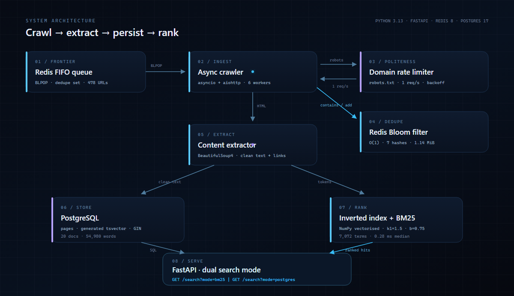
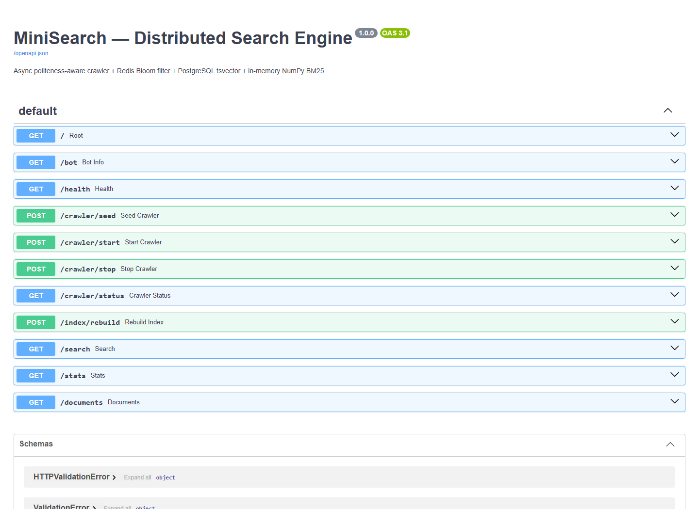

<div align="center">

# MiniSearch

### Distributed Web Crawler & Dual-Mode Search Engine

**Crawl politely. Deduplicate probabilistically. Rank from scratch.**

[](https://www.python.org/)
[](https://fastapi.tiangolo.com/)
[](https://www.postgresql.org/)
[](https://redis.io/)
[](tests/test_engine.py)

[Overview](#overview) · [Architecture](#architecture) · [Screenshots](#screenshots) · [Quick start](#quick-start) · [API](#api) · [Results](#verified-results)

</div>


## Overview

**MiniSearch** is a from-scratch retrieval stack — not a wrapper around
Elasticsearch or a hosted search API. It crawls with `asyncio` + `aiohttp`,
deduplicates URLs with a **Redis bitmap Bloom filter**, stores clean pages in
**PostgreSQL**, and ranks them with a **NumPy-vectorised BM25** implementation.

The same FastAPI service exposes two search engines over the same corpus:

- **In-memory BM25** — a hand-built inverted index with term-frequency
  saturation and document-length normalisation.
- **PostgreSQL `tsvector`** — native full-text search with a generated
  weighted vector and GIN index.

This makes the engineering trade-off directly visible: explicit control and
single-digit-millisecond retrieval versus database-native durability and zero
index-build step.

### Highlights

| Area | Implementation |
| --- | --- |
| Crawling | Async worker pool, `BLPOP` frontier, retries with exponential backoff |
| Politeness | Cached `robots.txt`, per-domain `asyncio.Lock`, 1 request/second/domain |
| Deduplication | Redis bitmap Bloom filter, O(1) checks, 7 hashes, ~1.14 MiB for 1M URLs |
| Extraction | BeautifulSoup4, boilerplate stripping, title + readable text + outbound links |
| Storage | PostgreSQL upserts, generated weighted `tsvector`, GIN + trigram indexes |
| Ranking | In-memory inverted index, NumPy BM25 (`k1=1.5`, `b=0.75`) |
| Serving | FastAPI, dual `/search` modes, Swagger docs, live demo UI |
| Validation | 7 unit tests + end-to-end Wikipedia crawl and query verification |

## Architecture



```text
Redis Frontier ──> Async Crawler <──> Politeness / robots.txt
                         │
                         ├──> Redis Bloom filter (dedupe)
                         ▼
                 Content Extractor
                    │          │
                    ▼          ▼
              PostgreSQL   Inverted Index + BM25
                    \          /
                     ▼        ▼
                  FastAPI dual-mode search
```

The crawler pops a URL from the Redis frontier, checks the Bloom filter,
applies the domain’s robots policy and rate limit, fetches with retries,
extracts readable content, and upserts it into PostgreSQL. Outbound links are
normalised, filtered, and pushed back to the frontier.

## Screenshots

### Dual search modes

<p align="center">
  
  
</p>

<p align="center">
  <sub><b>Left:</b> in-memory NumPy BM25 &nbsp;·&nbsp; <b>Right:</b> PostgreSQL <code>tsvector</code> + <code>ts_headline</code></sub>
</p>

### API documentation



The FastAPI service ships interactive OpenAPI docs at `/docs` and a custom
search interface at `/demo`.

## Verified results

Measured on this build machine after a real 20-page Wikipedia crawl:

| Metric | Result |
| --- | ---: |
| Pages stored | **20** |
| Clean words stored | **54,980** |
| Indexed vocabulary | **7,072** stemmed terms |
| Average document length | **1,837** tokens |
| BM25 median latency | **0.28 ms** |
| PostgreSQL median latency | **19.77 ms** |
| Unit tests | **7 / 7 passing** |

> Latency is server-side `took_ms`, `limit=5`, 10 runs, same query
> (`distributed computing networks`). Both engines return the Wikipedia
> **Distributed computing** article as the top result.

## Quick start

### Option A — Docker (recommended)

```bash
git clone https://github.com/Harsh-Dedha/web-crawler.git
cd web-crawler
docker compose up -d

python -m venv .venv
# Windows: .venv\Scripts\activate
# macOS/Linux: source .venv/bin/activate
pip install -r requirements.txt

uvicorn src.main:app --host 127.0.0.1 --port 8000
```

Open **http://127.0.0.1:8000/demo** for the search UI and
**http://127.0.0.1:8000/docs** for Swagger.

### Option B — Native Windows

This build machine did not have Docker, so the verified run used portable
PostgreSQL 17.6 and Redis 8.10.2 under `runtime/` (gitignored):

```powershell
.\scripts\start_infra.ps1
.\.venv\Scripts\python.exe -m uvicorn src.main:app --host 127.0.0.1 --port 8000
```

If `runtime/` is not present, use Docker or install PostgreSQL 16+ and Redis 7+
natively, then copy `.env.example` to `.env` and update the connection values.

### Stop everything

```powershell
.\scripts\stop_api.ps1
.\scripts\stop_infra.ps1
```

## API

| Method | Endpoint | Purpose |
| --- | --- | --- |
| `GET` | `/demo` | Search UI with BM25 / PostgreSQL toggle |
| `GET` | `/docs` | Interactive Swagger UI |
| `GET` | `/health` | Postgres + Redis health |
| `POST` | `/crawler/seed` | Push seed URLs into the frontier |
| `POST` | `/crawler/start?workers=6` | Start the async crawl workers |
| `POST` | `/crawler/stop` | Stop the crawl |
| `GET` | `/crawler/status` | Queue depth, Bloom bits, page counts |
| `POST` | `/index/rebuild` | Rebuild the in-memory BM25 index |
| `GET` | `/search?q=...&mode=bm25` | NumPy BM25 search |
| `GET` | `/search?q=...&mode=postgres` | PostgreSQL `tsvector` search |
| `GET` | `/stats` | Database, index, and crawler counters |

### Seed, crawl, index, search

```bash
curl -X POST "http://127.0.0.1:8000/crawler/seed" \
  -H "Content-Type: application/json" \
  -d '[
    "https://en.wikipedia.org/wiki/Distributed_computing",
    "https://en.wikipedia.org/wiki/Search_engine"
  ]'

curl -X POST "http://127.0.0.1:8000/crawler/start?workers=6"
curl "http://127.0.0.1:8000/crawler/status"

curl -X POST "http://127.0.0.1:8000/index/rebuild"

curl -G "http://127.0.0.1:8000/search" \
  --data-urlencode "q=distributed computing networks" \
  --data-urlencode "mode=bm25" \
  --data-urlencode "limit=5"

curl -G "http://127.0.0.1:8000/search" \
  --data-urlencode "q=distributed computing networks" \
  --data-urlencode "mode=postgres" \
  --data-urlencode "limit=5"
```

### Example response

```json
{
  "mode": "in-house-bm25",
  "query": "distributed computing networks",
  "count": 5,
  "took_ms": 0.28,
  "results": [
    {
      "doc_id": 1,
      "title": "Distributed computing",
      "url": "https://en.wikipedia.org/wiki/Distributed_computing",
      "score": 3.2817
    }
  ]
}
```

## How it works

### 1. Redis Bloom filter

One bitmap, no RedisBloom module, no extra plugin. The filter size and hash
count are derived from the expected element count `n` and false-positive rate
`p`:

```text
m = -(n * ln(p)) / (ln(2)^2)
k = (m / n) * ln(2)
```

For `n = 1,000,000` and `p = 0.01`:

- `m ≈ 9,585,058` bits (**~1.14 MiB**)
- `k = 7` hashes

All seven positions come from double hashing:

```text
g_i(x) = (h1(x) + i * h2(x)) mod m
```

A Redis `SET` storing the same URLs would consume orders of magnitude more
memory. Bloom false positives can skip an unseen URL, but there are no false
negatives for inserted URLs, so cycles cannot re-enter the frontier.

### 2. Politeness and resilience

- `robots.txt` fetched once per domain, cached, and parsed with
  `urllib.robotparser`.
- Per-domain `asyncio.Lock` + monotonic timestamp enforces a configurable
  delay (default **1.0 s**) without blocking other domains.
- `429` and `5xx` responses retry with exponential backoff; `Retry-After` is
  honoured when present.
- `CRAWLER_MAX_PAGES` is a hard cap, even with multiple workers in flight.

### 3. Inverted index and BM25

The index stores:

```text
term -> [(doc_id, term_frequency), ...]
doc_id -> token_count
doc_id -> {title, url, domain, snippet}
```

At query time, postings are cast to contiguous NumPy arrays and scored with:

```text
score(D, Q) = Σ IDF(q) * (tf * (k1 + 1)) /
              (tf + k1 * (1 - b + b * (|D| / avgdl)))
```

with `k1 = 1.5`, `b = 0.75`, and Lucene-style non-negative IDF. A fresh index
is built in a worker thread and swapped in atomically, so `/index/rebuild`
does not block the event loop.

### 4. PostgreSQL full-text search

`tsv_content` is a generated `tsvector`:

```sql
setweight(to_tsvector('english', coalesce(title, '')), 'A') ||
setweight(to_tsvector('english', coalesce(content_clean, '')), 'B')
```

A GIN index backs the vector. `mode=postgres` uses `plainto_tsquery` and
`ts_rank_cd`, with `ts_headline` producing highlighted snippets.

## Project structure

```text
web-crawler/
├── src/
│   ├── bloom_filter.py      # Redis bitmap Bloom filter
│   ├── politeness.py        # robots.txt + per-domain throttling
│   ├── crawler.py           # async fetch, parse, index pipeline
│   ├── db.py                # asyncpg pool + queries
│   ├── stemmer.py           # tokenizer + suffix stemmer
│   ├── indexer.py           # inverted index builder
│   ├── bm25.py              # NumPy BM25 ranker
│   ├── main.py              # FastAPI app + demo route
│   └── static/index.html    # dual-mode search UI
├── docs/
│   ├── architecture.svg
│   └── screenshots/
├── scripts/
│   ├── start_infra.ps1
│   ├── stop_infra.ps1
│   ├── stop_api.ps1
│   └── smoke_test.ps1
├── tests/test_engine.py
├── schema.sql
├── docker-compose.yml
├── requirements.txt
└── config.py
```

## Tests

```bash
python -m unittest discover -s tests -v
```

Coverage includes Bloom sizing and hash determinism, stemming, URL
normalisation, link filtering, BM25 ranking, and empty-index behaviour.

## Design notes

- **Single-process index.** BM25 lives in the API process. Multiple Uvicorn
  workers or replicas would each build their own index; a shared index service
  would be the next step.
- **Bloom trade-off.** False positives are acceptable because they only skip a
  page; false negatives are impossible for inserted URLs.
- **Corpus scope.** The checked-in `.env` limits the demo crawl to
  `en.wikipedia.org` with a 20-page cap. Remove `CRAWLER_ALLOWED_DOMAINS` to
  crawl every discovered host.
- **Docker path.** `docker-compose.yml` is included for environments with
  Docker. The verified run on this machine used native binaries because Docker
  was unavailable.
- **Dependency pins.** The original 2024 pins targeted Python 3.12. This build
  uses Python 3.13-compatible versions (NumPy 2.x, asyncpg 0.32, etc.).

## Author

Built by **[Harsh Dedha](https://github.com/Harsh-Dedha)**.

If this project is useful or interesting, a star is appreciated.
